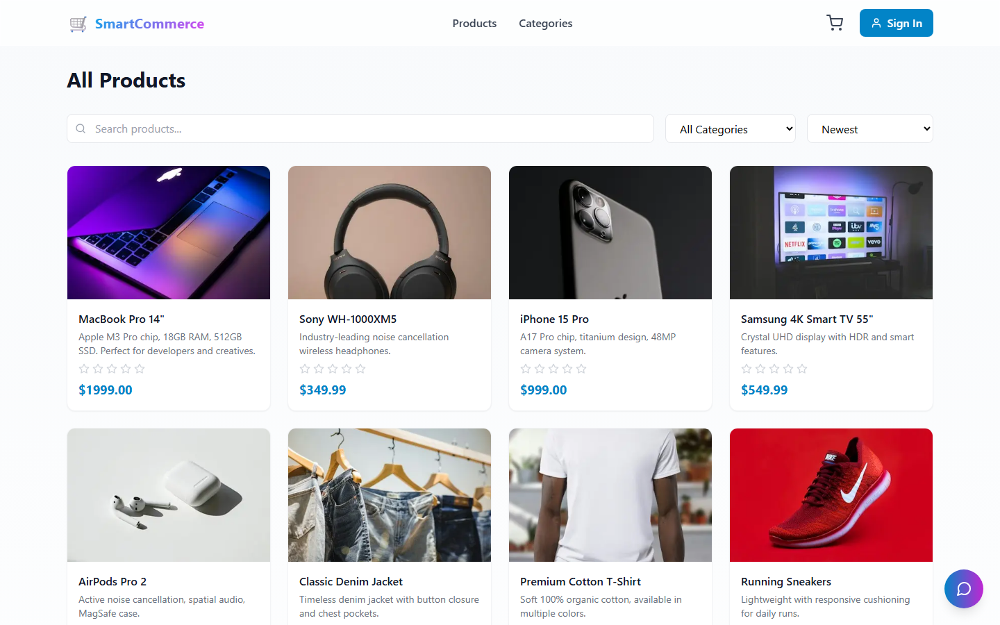
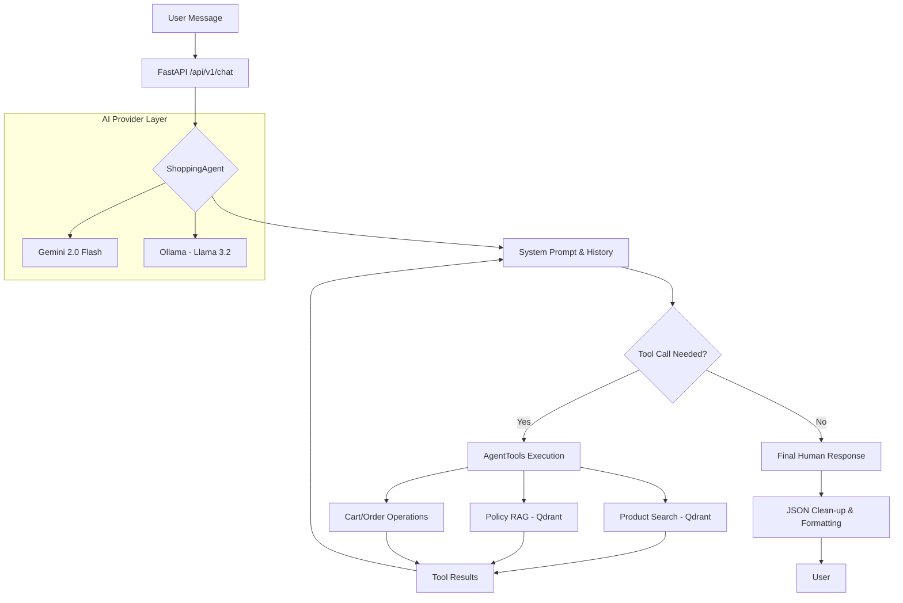

# SmartCommerce AI

🛒 **AI-Powered E-Commerce Platform** with semantic search, personalized recommendations, and a conversational shopping assistant.



**Live demo:** https://smart-commerce-ai-ivory.vercel.app · demo login `testuser` / `password123` (the free-tier backend sleeps when idle, so the first request can take up to a minute)

## ✨ Features

### 🤖 AI-Powered
- **Conversational Shopping Agent** - Chat with Gemini-powered assistant to find products, manage cart, and get answers
- **Semantic Search** - Find products by meaning, not just keywords
- **Personalized Recommendations** - Get suggestions based on your cart and order history
- **RAG-Based Policy Q&A** - Instant answers about shipping, returns, and policies

### 🛍️ E-Commerce
- **Product Catalog** - Browse with filters, categories, and sorting
- **Shopping Cart** - Add, update, and manage items
- **Checkout Flow** - Multi-step checkout with mock payment
- **Order Management** - Track your order history

### 🔐 Security
- **JWT Authentication** - Secure token-based auth
- **Password Hashing** - BCrypt for secure password storage
- **Role-Based Access** - Admin and customer roles

## 🏗️ Architecture

(For a high-level overview, see the component diagram above.)

## 🧠 AI Architecture & Flow

The SmartCommerce AI Assistant ("Smarty") uses a sophisticated agentic loop to handle user requests, ranging from semantic product discovery to complex cart management.



### Key AI Components:
- **Multi-Provider Support**: Switch between **Google Gemini** (cloud) and **Ollama** (local) via `.env`.
- **Hybrid Search**: Combines traditional filtering with **Vector Embeddings** (`gemini-embedding-001`, 768 dims) for semantic matching.
- **RAG System**: Policy questions (returns, shipping) are answered by chunking documents and performing similarity search in Qdrant.
- **Tool-Calling Loop**: Uses a recursive loop (up to 5 turns) to ensure complex requests (search -> details -> add) are handled in a single message turn.

```
┌────────────────┐     ┌────────────────┐     ┌────────────────┐
│   Next.js 14   │────▶│   FastAPI      │────▶│  PostgreSQL    │
│   (Frontend)   │     │   (Backend)    │     │   (Database)   │
└────────────────┘     └────────────────┘     └────────────────┘
                              │
                              ├────────────────┐
                              │                │
                       ┌──────▼─────┐   ┌──────▼─────┐
                       │   Qdrant   │   │   Redis    │
                       │  (Vectors) │   │  (Cache)   │
                       └────────────┘   └────────────┘
                              │
                       ┌──────▼─────┐
                       │   Gemini   │
                       │   (AI)     │
                       └────────────┘
```

## 🚀 Quick Start

### Helper Tools
- **Docker Desktop** (Required for containerization)
- **Node.js 18+** (For local frontend development)
- **Ollama** (Optional: For free, local AI models)

### 1. Setup Local AI (Optional)
If you want to use the free **Llama 3.2** model instead of Google Gemini:
```bash
cd smartcommerce-ai-backend
chmod +x scripts/setup_ollama.sh
./scripts/setup_ollama.sh
```

### 2. Start the Application

```bash
cd SmartCommerce_AI

# Backend
cd smartcommerce-ai-backend
cp .env.example .env
# Edit .env and add your GOOGLE_API_KEY
```

### 2. Start Services

```bash
# Start backend (PostgreSQL, Redis, Qdrant, FastAPI)
cd smartcommerce-ai-backend
docker-compose up -d

# Wait for services to be healthy, then seed data
docker-compose exec api python scripts/seed_products.py
docker-compose exec api python scripts/index_vectors.py
docker-compose exec api python scripts/index_policies.py

# 3. Verify AI Bot (Optional)
Run the automated test suite to verify the AI assistant:
```bash
python3 scripts/test_bot.py
```
```

### 3. Start Frontend

```bash
cd ../smartcommerce-ai-frontend
npm install
npm run dev
```

### 4. Access

- **Frontend**: http://localhost:3000
- **API Docs**: http://localhost:8000/docs
- **Qdrant UI**: http://localhost:6333/dashboard

### Demo Credentials
- **Username**: `testuser`
- **Password**: `password123`

## 📁 Project Structure

```
SmartCommerce_AI/
├── smartcommerce-ai-backend/
│   ├── app/
│   │   ├── api/v1/          # API endpoints
│   │   ├── ai/              # AI services (embeddings, RAG, agent)
│   │   ├── core/            # Security, exceptions
│   │   ├── db/              # Database session
│   │   ├── models/          # SQLAlchemy models
│   │   ├── schemas/         # Pydantic schemas
│   │   └── services/        # Business logic
│   ├── policies/            # RAG documents
│   ├── scripts/             # Seed & indexing scripts
│   ├── docker-compose.yml
│   └── requirements.txt
│
└── smartcommerce-ai-frontend/
    └── src/
        ├── app/             # Next.js pages
        ├── components/      # React components
        └── lib/             # Stores, utilities
```

## 🔌 API Endpoints

### Authentication
| Method | Endpoint | Description |
|--------|----------|-------------|
| POST | `/api/v1/auth/register` | Register new user |
| POST | `/api/v1/auth/login` | Login |
| GET | `/api/v1/auth/me` | Get current user |

### Products
| Method | Endpoint | Description |
|--------|----------|-------------|
| GET | `/api/v1/products` | List products (paginated, filterable) |
| GET | `/api/v1/products/{slug}` | Get product details |
| GET | `/api/v1/categories` | List categories |

### Cart & Orders
| Method | Endpoint | Description |
|--------|----------|-------------|
| GET | `/api/v1/cart` | Get cart |
| POST | `/api/v1/cart/items` | Add to cart |
| POST | `/api/v1/orders` | Create order (checkout) |
| GET | `/api/v1/orders` | List orders |

### AI & Search
| Method | Endpoint | Description |
|--------|----------|-------------|
| GET | `/api/v1/search?q=...` | Semantic search |
| GET | `/api/v1/recommendations` | Personalized recommendations |
| GET | `/api/v1/products/{id}/similar` | Similar products |
| POST | `/api/v1/chat` | Chat with AI assistant |

## 🛠️ Tech Stack

### Backend
- **FastAPI** - High-performance Python API
- **SQLAlchemy** - Async ORM with PostgreSQL
- **Qdrant** - Vector database for embeddings
- **Redis** (optional) - Embedding cache and chat memory; falls back to in-process storage when `REDIS_URL` is empty
- **Google Gemini** - Embeddings and chat

### Frontend
- **Next.js 14** - React framework
- **Tailwind CSS** - Utility-first styling
- **Zustand** - State management
- **React Icons** - Icon library

## ☁️ Free-tier deployment

The repo is set up to run on free hosting with no Docker host of your own:

| Piece | Where | Notes |
|---|---|---|
| Frontend (Next.js) | Vercel | Root directory `smartcommerce-ai-frontend`. Set `BACKEND_URL` **before** the first build: rewrites are baked in at build time. |
| Backend (FastAPI) | Render (free, Docker) | `render.yaml` blueprint at the repo root |
| PostgreSQL | Neon (free) | Paste the connection string into `DATABASE_URL`; `sslmode=require` is handled automatically |
| Vector search | In-process Qdrant | `QDRANT_URL=:memory:`, rebuilt from Postgres on startup |
| LLM + embeddings | Gemini API | `GOOGLE_API_KEY`; models are configurable via `CHAT_MODEL` / `EMBEDDING_MODEL` |

With `AUTO_BOOTSTRAP=true` the API seeds the catalog and builds the vector index on first start, so no manual scripts are needed. Chat is rate limited per user (`CHAT_RATE_LIMIT_PER_HOUR`) and globally (`CHAT_DAILY_LIMIT`) to protect the API quota, and the seeded admin password comes from `ADMIN_PASSWORD` (Render generates one).

## 📄 License

MIT License - feel free to use this for your portfolio or projects!